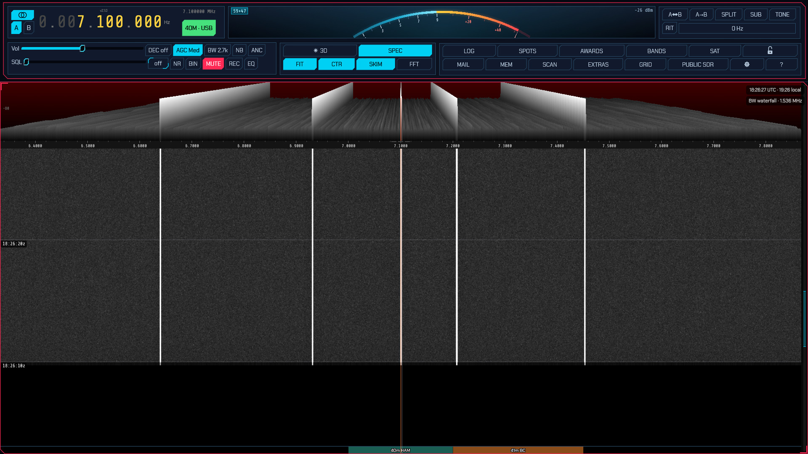

# SDRCrow

<center></center>

**The radio you point at the 11 m band, or at a shortwave evening.** A
software-defined-radio receiver and transceiver in one program: a native desktop
window, a browser client served from the same engine, radios reached by CAT, by
network or by sound card, the digital modes and decoders, and a logbook beside
them. Built for the operator who actually listens — the CB and shortwave bands
first, and the amateur bands with the same care.



## What it does

**Tuning and looking.** A panadapter and waterfall with click and drag tuning,
scroll to zoom, a draggable filter passband, a colour-coded band-plan strip and
eight waterfall schemes. Two VFOs with split, and a sub-receiver you can tune
separately with its own mode and filter.

**The modes you need.** LSB, USB, CW, AM, SAM, C-QUAM, NFM, WFM, DRM, HD Radio
(NRSC-5), DIGU, DIGL, DSB, ISB — two services on one carrier, one in each ear —
and a spectrum-only mode.

**Every digital mode that matters on the bands.** FT8, FT4 and FT2; JS8; PSK31,
RTTY, JTTY, Olivia, Contestia, MT63, ARDOP, THOR, MFSK, FSQ, Hellschreiber;
weather fax and SSTV; RIFP; RF Paint; AX.25 packet and APRS with a live map;
ADS-B (1090 MHz) and AIS (162 MHz) drawn on their own displays; HFDL, ACARS,
VDL2, NAVTEX, DSC and AtCHAT NET; ALE and CIS-11; the naval STANAG 4285.

**Receive tools that earn their place.** AGC, squelch with CTCSS/DCS, an impulse
noise blanker, an adaptive auto-notch, five noise-reduction engines, front-end
decimation, RIT, and broadcast stereo with RDS on WFM.

**A transmitter, when the radio has one.** PTT, TUNE, drive and mic gain, XIT, a
transmit meter over ALC/power or SWR, an SWR guard that stops the over and latches
transmit out, a ham-band transmit lockout that vets the emission, repeater shift
and tones, and a monitor of your own signal while you transmit.

**CW the way it should be.** A Morse decoder that finds the speed, the threshold
and the spacing for itself, a cursor that picks the signal to copy, type-ahead
sending, and a wideband CW skimmer over the whole span.

**A logbook and the things around it.** Contacts with the station's details,
awards and spotting (DX cluster, POTA, SOTA, PSK Reporter), signal identification,
contest logging, QSL upload and Winlink radio email.

**Listening, not just operating.** Broadcast and utility bands with their own
menu, Radio Classic — a face with bands, memories, schedule, S-meter, stereo VU
and a nine-digit VFO for shortwave evenings — and a solar system view for the
propagation.

**Two faces of one engine.** The same program runs as a desktop application or as
a server: `sdrcrow --server`, then open `http://<host>:4950` in a browser and the
whole station is there — waterfall, modes, logbook — on a laptop, a tablet or a
phone. Remote operation over TLS is built in.

**And the small things.** A voice keyer with ten messages, MIDI control surfaces
(a VFO knob, a PTT button, faders), a desk microphone and a pedal as PTT,
spoken announcements, a headless station on a Raspberry Pi Zero 2 W, and an
experimental **ultra narrowband voice** mode for when nothing else gets through.

## Download

Linux, macOS and Windows builds and the browser client are on the
[latest release](https://github.com/madmedicnl/sdrcrow/releases). `<v>` is the
version, e.g. `1.2.0`.

| file | what |
|---|---|
| `sdrcrow-v<v>-linux-x86_64.tar.gz` | the standard Linux build — no SoapySDR needed |
| `sdrcrow-v<v>-linux-x86_64.deb` | the same as a Debian package |
| `sdrcrow-v<v>-linux-x86_64-soapysdr.deb` | with SoapySDR device support |
| `sdrcrow-v<v>-linux-x86_64.AppImage` | one file, run it |
| `sdrcrow-v<v>-macos-x86_64.dmg` / `.tar.gz` | macOS, Intel |
| `sdrcrow-v<v>-macos-aarch64.dmg` / `.tar.gz` | macOS, Apple silicon |
| `sdrcrow-v<v>-windows-x86_64.msi` / `.zip` | Windows installer and portable folder |
| `sdrcrow-web-v<v>.zip` | the browser client, to serve from a web server |
| `SHA256SUMS` | the checksums |

**Which one?** Take the **standard** build unless your device needs SoapySDR
(HackRF, Airspy R2/Mini, PlutoSDR, LimeSDR, USRP) — standard drives RTL-SDR,
RX-888, Airspy HF+, SDRplay, ELAD, CAT rigs and sound-card radios directly, with
nothing to install alongside. The installers are standard only. Every build
embeds the browser client.

## Install

```sh
# Debian, Ubuntu, Mint …
sudo dpkg -i sdrcrow-v<v>-linux-x86_64.deb

# anywhere, one file
chmod +x sdrcrow-v<v>-linux-x86_64.AppImage
./sdrcrow-v<v>-linux-x86_64.AppImage

# or from the tarball
tar xzf sdrcrow-v<v>-linux-x86_64.tar.gz
sudo install -m755 sdrcrow-v<v>-linux-x86_64/usr/bin/sdrcrow /usr/local/bin/
```

Or from source — Rust (stable) and, for the SDR backends, whatever their own
SDKs need:

```sh
cargo build --release -p sdrcrow
./target/release/sdrcrow
```

A first start creates `~/.config/sdrcrow` and begins from defaults.
`SDRCROW_CONFIG_DIR` points the program at another profile.

**A USB sound card is a radio.** A CB set with audio in and out — no CAT, no
meters — is a supported front end: pick it as the radio, key it by VOX, and the
program treats it like any other transceiver. The same is true of a handheld's
audio, of a KiwiSDR, or of a receiver on the desk beside the transmitter.

## Documentation

- **[User Manual](docs/USER_MANUAL.md)** — every screen, every mode, every
  setting, the command line and the configuration files.
- **[Quick starts](docs/)** — CB/11 m, FT8 on 11 m, shortwave listening, HF
  weather, QO-100, SSTV, and a headless station on a Pi Zero 2 W, in English,
  French, Italian and Dutch, each as Markdown and as a PDF.
- **[CHANGELOG](CHANGELOG.md)** — what each release changed.

## Thank you

This program is built by one operator for other operators, and a lot of what
makes the bands work is done by people who are not paid for it and rarely hear
thanks. So, sincerely:

- to **[Dutch CB Group](https://dutchcbgroup.nl)** — for the channel plans and
  the division list that Dutch 11 m operators actually use, kept current year
  after year;
- to the **[VERON](https://veron.nl)** — for a century of representing and
  teaching Dutch radio amateurs, and for the material that makes the hobby
  approachable to someone new;
- to **[LOG11DX](https://log11dx.com)** and **[11DX.net](https://11dx.net)** —
  for the DX logs, the spots and the news that keep 11 metres a living band
  rather than a frequency on a chart.

Thank you for the work you do for the radio community. If this program is useful
on your desk, some of the credit is yours.

## Licence

SDRCrow is free software under the **GNU General Public License, version 3 or
later**. The full text is in [LICENSE](LICENSE); the notices of the parts it
carries or embeds (the RX-888 firmware, the CMU dictionary, the DeepCW model and
the speech voice) ship with the packages and in `crates/*/LICENSE`.
